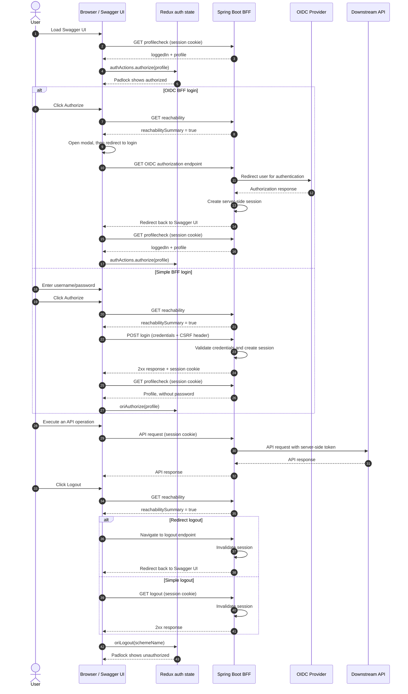

# Extending Swagger UI: A BFF Authentication Tutorial

**Audience:** Java developers who are new to React/Redux. You understand Spring Boot, Maven, and session-based auth. You can read TypeScript but are not an expert. JSX will be explained as we go.

---

## 1. The Goal

Standard Swagger UI supports authentication mechanisms such as API keys, HTTP Basic, HTTP Bearer, and OAuth2. It has no concept of a **Backend-for-Frontend (BFF)** pattern.

**What BFF means here:** Your Spring Boot app acts as an OAuth2 client. The browser never sees access or refresh tokens; they remain server-side. The user logs in through the server-side (session cookie), and every API call from the browser goes to the same origin — the session proves identity. When Swagger UI calls your API, it must include the session cookie, not a bearer token.

**Problem:** Swagger UI's authorize modal only knows how to send `Authorization: Bearer ...` headers. It does not know how to log in against a form endpoint, hold a session, or redirect to an OIDC login page.

**Solution:** This project extends Swagger UI so that when your OpenAPI spec declares a security scheme of type `http` with `scheme: bff`, Swagger UI will:
- Show a username/password form (for simple BFF) or redirect to your OIDC login page (for OIDC BFF)
- POST credentials to your BFF login endpoint and read back the session
- Probe a "reachability" URL before attempting login/logout so error messages are actionable
- Pre-restore the session state on page load by hitting a profile endpoint

The extension is then packaged as a Maven WebJar so any Spring Boot app can consume it with one `<dependency>`.

---

## 2. The Big Picture — File Map

```
swagger-ui-my-bff-extn/src/
├── core/
│   ├── index.js                            ← Modified: registers BffPlugin
│   ├── plugins/
│   │   ├── bff/
│   │   │   └── index.js                   ← NEW: the heart of the extension
│   │   └── oas3/
│   │       └── components/
│   │           └── auth/
│   │               └── http-auth.jsx      ← Modified: adds bff rendering branch
│   ├── components/
│   │   ├── auth/
│   │   │   ├── auth-item.jsx              ← Modified: adds type: bff case (not used by demos)
│   │   │   └── bff-auth.jsx              ← NEW: form for the separate type: bff route
│   │   ├── bff/
│   │   │   └── bff-enabler.jsx           ← NEW: invisible session-restore component
│   │   └── layouts/
│   │       └── base.jsx                  ← Modified: mounts BffEnabler in the layout
│   └── presets/
│       └── base/
│           ├── index.js                   ← Modified: adds BffPlugin to preset
│           └── plugins/
│               └── core-components/
│                   └── index.js           ← Modified: registers BffEnabler + BffAuth
```

All these files are **overlaid** on top of the upstream Swagger UI source by Maven before building. None of the upstream Swagger UI source is forked — only these specific files replace their counterparts.

---

| Responsibility | React / Swagger UI Side | Java Backend Side |
|---|---|---|
| Form login | Collects credentials and POSTs them to the configured login endpoint. | Spring Security authenticates the user and establishes an HTTP session. |
| OIDC login | Redirects the browser to the configured BFF login URL. | Handles the OIDC flow and redirects back to the appropriate UI. |
| Profile check | `BffEnabler` fetches the profile and updates Redux authorization state. | Returns `loggedIn` and profile information through the profile endpoint. |
| CSRF | Adds the CSRF header through the plugin’s login helper or the consumer’s “Try it out” interceptor. | Issues the CSRF cookie and validates the submitted header. |
| API execution | “Try it out” sends browser cookies and the required CSRF header. | Enforces the endpoint’s access rules and CSRF protection. See - simple.bff/src/main/resources/config/swagger-initializer.js and oidc.bff/src/main/resources/config/swagger-initializer.js in the demo projects. |
| Logout | Calls or navigates to the configured logout endpoint. | Invalidates the HTTP session and handles OIDC logout where applicable. |
| Reachability, when configured | Probes the endpoint before proceeding with login/logout. | Reports availability; the OIDC demo also checks the identity provider. |


## 3. How the Build Works (Maven Overlay Pattern)

Think of this like a WAR overlay in Java EE — you take an upstream artifact and replace specific files before packaging.

**`pom.xml` does this in phases:**

| Maven Phase | What happens |
|---|---|
| `initialize` | `wagon-maven-plugin` downloads `swagger-ui-5.32.8.zip` from GitHub |
| `generate-sources` | `maven-antrun-plugin` unzips it to `target/downloads/swagger-ui-5.32.8/` |
| `generate-sources` | `maven-resources-plugin` copies the full upstream source to `target/swagger-bff-ui-5.32.8-1.0.0/` |
| `generate-sources` | `maven-resources-plugin` **overlays** `swagger-ui-my-bff-extn/src/` on top with `<overwrite>true</overwrite>` |
| `generate-sources` | `frontend-maven-plugin` runs `npm install` in the overlay directory |
| `process-sources` | `frontend-maven-plugin` runs `npm run build` in the overlay directory |
| `process-resources` | The built `dist/` is copied into WebJar layout: `META-INF/resources/webjars/swagger-ui/` |
| `package` | `maven-jar-plugin` packages everything as a jar |

**Key insight:** The overlay step is:

**Abbreviated XML excerpt:** Enclosing Maven configuration is omitted.

```xml
<!-- pom.xml, second copy-resources execution -->
<outputDirectory>.../swagger-bff-ui-.../src</outputDirectory>
<overwrite>true</overwrite>
<resources>
  <resource>
    <directory>${project.basedir}/swagger-ui-my-bff-extn/src</directory>
  </resource>
</resources>
```
Only files that exist in `swagger-ui-my-bff-extn/src/` overwrite the upstream. Everything else stays untouched. webpack then builds the whole thing as one bundle.

---

## 4. React Basics — What You Need to Know

### 4.1 Components = Classes (or Functions) That Return UI

Think of a React component like a Java class that has a `render()` method. The `render()` method returns **JSX** — which looks like HTML but is actually syntactic sugar for JavaScript function calls.

**Illustrative snippets:** JSX and its compiled equivalent, not a complete component.

```jsx
// This JSX:
return <div className="foo"><h1>Hello</h1></div>

// Is compiled to:
return React.createElement("div", { className: "foo" },
  React.createElement("h1", null, "Hello")
)
```

**Rule:** JSX is not HTML. `class` becomes `className`. `for` becomes `htmlFor`. Everything must be closed.

### 4.2 Props = Constructor Arguments

Props are how you pass data into a component from its parent. Think of them as constructor parameters that you cannot change from inside the component.

**Illustrative snippets:** Parent JSX and child `render()` method; component definitions are omitted.

```jsx
// Parent renders:
<MyButton label="Click me" onClick={handleClick} />

// Inside MyButton, you access them via this.props:
render() {
  return <button onClick={this.props.onClick}>{this.props.label}</button>
}
```

In Java terms: `props` is like a read-only `@Value`-injected field.

### 4.3 State = Mutable Internal Data

`this.state` is data the component owns and can change. Calling `this.setState({...})` triggers a re-render — like a reactive property. Never mutate `this.state` directly.

**Illustrative snippets:** Initialization and update statements from different points in a component.

```jsx
// Initialize in constructor:
this.state = { username: "", password: "" }

// Update it:
this.setState({ username: "alice" })
// React then re-calls render() automatically
```

In Java terms: `state` is like a field that, when you set it via a setter, automatically refreshes the view.

### 4.4 Lifecycle: componentDidMount

`componentDidMount()` is called once, right after the component's DOM is added to the page — like `@PostConstruct` in Spring. This is where you do HTTP calls, because by this point all props are available and the DOM exists.

### 4.5 Class Component vs Function Component

React's modern recommendation is to write **function components** with Hooks for new code. React still fully supports **class components**, and this Swagger UI extension keeps using them because the surrounding Swagger UI codebase is already class-based and this tutorial mirrors that style for consistency.

If you want to self-study both styles without setting up anything locally, use React's official docs. They include runnable examples in the browser:

- [React quick start](https://react.dev/learn) - best place to learn function components, props, state, events, and Hooks with interactive examples.
- [React `Component` reference](https://react.dev/reference/react/Component) - shows class components, lifecycle methods, and how class-based code maps to function components.

For this tutorial, read the examples as "class component first", then compare them with the equivalent function-component examples in the official docs when you want the modern version.

### 4.6 What To Remember

- Use function components when starting fresh in a new React app.
- Use class components here when you need to match the existing Swagger UI codebase and its extension points.
- Use the official React docs above when you want runnable examples and a side-by-side path from class-based code to function-based code.

---

## 5. Redux Basics — What You Need to Know

Swagger UI uses Redux for all shared state (which schemes are authorized, errors, spec content, etc.).

Think of Redux like this Java analogy:

| Redux concept | Java analogy |
|---|---|
| **Store** | A singleton service holding all application state |
| **State** | The data fields in that service |
| **Action** | A command object (like a DTO) dispatched to change state |
| **Reducer** | The handler that processes an action and returns new state |
| **Selector** | A query method that reads from the state |
| **Action creator** | A factory method that builds action objects |

In Swagger UI specifically, these are grouped into **plugins** using a structure called `statePlugins`:

**Plugin skeleton (pseudocode):** `...` stands for omitted configuration.

```js
const MyPlugin = () => ({
  statePlugins: {
    auth: {
      actions: { myAction: (payload) => ({ type: "MY_ACTION", payload }) },
      reducers: { "MY_ACTION": (state, action) => state.set("foo", action.payload) },
      selectors: { getFoo: (state) => state.get("foo") },
      wrapActions: { ... }  // intercept existing actions
    }
  }
})
```

### The Power Tool: wrapActions

`wrapActions` lets you intercept an existing action in swagger-ui before it fires. This is how you extend behavior without modifying core code.

**Illustrative wrapper excerpt:** `doSomethingExtra()` is a placeholder for your added behavior.

```js
wrapActions: {
  logout: (oriLogout, system) => (payload) => {
    // your code first
    doSomethingExtra()
    // then call the original
    oriLogout(payload)
  }
}
```

`oriLogout` is the original logout action. `system` is the entire Swagger UI system — you can call any action or selector from it. `payload` is what the caller passed in.

In Java terms: this is the **Decorator pattern** applied to Redux actions.
That said its upto the problem statement whether the super method should be called before, after or not at all w.r.t the added logic.    

---

## 6. Swagger UI's Plugin and Component System

### 6.1 Plugins

A plugin is a plain JavaScript function that returns an object describing what it contributes:

**Plugin skeleton (pseudocode):** `...` stands for omitted contributions.

```js
const MyPlugin = () => ({
  components: { ... },      // UI components registered by name
  statePlugins: { ... },    // Redux slice (actions/reducers/selectors/wrapActions)
})
```

### 6.2 Component Registry — getComponent()

Instead of importing React components directly, Swagger UI maintains a registry. You register a component under a name, and anywhere in the codebase you can get it by that name:

**Illustrative snippets:** Registration and lookup are separate parts of the application.

```js
// Register:
components: { myWidget: MyWidgetComponent }

// Retrieve anywhere:
const MyWidget = getComponent("myWidget")
// then use:
return <MyWidget foo="bar" />
```

The second argument `true` means "connect to Redux store" (equivalent to `connect()` in older Redux):

**Component-lookup excerpt:**

```js
const BffEnabler = getComponent("BffEnabler", true)
```

**Why this matters:** You can replace any built-in component by registering your own under the same name. That is how Swagger UI was designed to be extended.

### 6.3 Presets

A preset is just a function that returns an array of plugins. `BasePreset` is the list of all plugins that make Swagger UI work. By adding your plugin to `BasePreset`, you guarantee it is always loaded.

---

## 7. How These Pieces Work Together — End-to-End Flow

The sequence below shows the browser as the only client of the BFF. The session cookie travels with same-origin requests, while tokens remain between the BFF and the identity provider or downstream API. The `alt` branches show the differences between OIDC redirect login and simple form login.



**Flow outlines:** The following call sequences summarize the paths; they are not executable code.

### Page Load (Session Restore)

```
BaseLayout renders
  → <BffEnabler /> mounts
  → componentDidMount fires
  → fetch(def["x-bff-profilecheck"], { credentials: "include" })
  → if json.loggedIn → authActions.authorize({scheme: {name, schema, value: json}})
  → Redux state updated → padlock icon shows as locked
```

### User Clicks Lock → Opens Authorize Modal (OIDC BFF)

```
User clicks AuthorizeBtn
  → auth.showDefinitions dispatched
  → BffPlugin.wrapActions.showDefinitions intercepts
  → probeReachability(def["x-bff-reachability"])
  → if reachable → oriShowDefinitions() → modal opens
  → OAS3 AuthItem wrapper selects <HttpAuth /> for type="http"
  → HttpAuth renders scheme="bff", x-bff-redirectforlogin=true
  → setTimeout → window.location.href = def["x-bff-login"]  (browser navigates to OIDC login)
  → After OIDC → BFF server creates session, redirects back
  → BffEnabler fires on return, restores state
```

### User Clicks Lock → Opens Authorize Modal (Simple BFF)

```
User clicks AuthorizeBtn
  → modal opens → OAS3 AuthItem wrapper selects <HttpAuth /> for type="http"
  → HttpAuth renders inline inputs for scheme="bff", x-bff-redirectforlogin=false
  → User types username/password → onChange → this.state updated
  → User clicks "Authorize"
  → auth.authorize dispatched with { schemeName: { value: { username, password } } }
  → BffPlugin.wrapActions.authorize intercepts
  → applyBffRequestPolicy (adds CSRF header)
  → fetch POST to def["x-bff-login"] with URLSearchParams body
  → if 401 → show "Invalid credentials."
  → if ok → fetch def["x-bff-profilecheck"] → oriAuthorize with profile
  → Redux state updated → padlock locked
```

### User Clicks Logout (Simple BFF)

```
User clicks Logout button
  → auth.logout dispatched
  → BffPlugin.wrapActions.logout intercepts
  → canProceedWithReachability (probes only if x-bff-reachability is configured)
  → if the probe fails → show error and stop; keep authorization state unchanged
  → otherwise → fetch(def["x-bff-logout"])
  → after the fetch succeeds or fails → oriLogout([schemeName])
  → Redux state cleared → padlock unlocked
```

---

## 8. The OpenAPI Spec Side

For this to work, the consumer app's OpenAPI spec declares the security scheme like this:

**Simple BFF (form login) - OpenAPI fragment:**
```yaml
components:
  securitySchemes:
    bff-simple:
      type: http
      scheme: bff
      x-bff-login: /login
      x-bff-logout: /apilogout
      x-bff-profilecheck: /shortprofile
      x-bff-redirectforlogin: false
      x-bff-redirectforlogout: false
      x-bff-reachability: /reachability
```

**OIDC BFF (redirect) - OpenAPI fragment:**
```yaml
components:
  securitySchemes:
    bff-oidc:
      type: http
      scheme: bff
      x-bff-login: /oauth2/authorization/my-provider
      x-bff-logout: /apilogout
      x-bff-profilecheck: /shortprofile
      x-bff-redirectforlogin: true
      x-bff-redirectforlogout: true
      x-bff-reachability: /reachability
```

Swagger UI passes the whole schema object through to the plugin. Fields like `x-bff-login`, `x-bff-logout`, `x-bff-profilecheck`, `x-bff-redirectforlogin`, `x-bff-redirectforlogout`, and `x-bff-reachability` are read via `schema.get("x-bff-login")` (Immutable.js Map lookup) or `def["x-bff-login"]` (plain JS object after `.toJS()`). The key names themselves are centralized as constants in `swagger-ui-my-bff-extn/src/core/plugins/bff/extension-keys.js` and imported wherever they're read, rather than repeated as string literals. The `bff-` namespace segment (rather than a bare `x-login`) follows the same convention as `x-amazon-apigateway-*`, `x-ms-*`, etc. — it scopes these fields to this specific plugin and avoids colliding with any other tool's extensions on the same document.

### Plugin Contract

The plugin expects the following HTTP/OpenAPI contract, regardless of the backend application's language or framework.

**Custom convention:** `type: http`, `scheme: bff` identifies this extension's BFF behavior. It is not built-in BFF support in standard Swagger UI.

**Profile response:** The `x-bff-profilecheck` endpoint returns JSON with boolean `loggedIn` and, when logged in, a `name` for display.

Logged out:
```json
{"loggedIn": false}
```

Logged in:
```json
{"loggedIn": true, "name": "Alice"}
```

**Form login:** With `x-bff-redirectforlogin: false`, the plugin POSTs `username` and `password` to `x-bff-login` as `application/x-www-form-urlencoded`. A successful 2xx response triggers the profile check; a 401 response produces "Invalid credentials."

**Redirect flows:** For redirect-based login or logout, the plugin navigates to the configured URL. The application must arrange the return to Swagger UI; the plugin does not determine the return URL.

**Operation security:** Declaring a scheme under `components.securitySchemes` does not associate it with operations. Reference it using `security` at the document root or inside an individual operation. For the `bff-simple` scheme above:

**OpenAPI fragment:** Security requirement only, not a complete document.

```yaml
security:
  - bff-simple: []
```

This describes security requirements; the backend remains responsible for enforcing them.

---

## 9. Change-by-Change Walkthrough

**Reading the snippets:** These are selected or simplified excerpts, not complete replacement files. `...` marks omitted code and is not executable JavaScript. Some excerpts spell out `x-bff-*` keys for readability; the implementation uses the constants described in Section 8. Use the referenced source files for the full implementation.

---

### Change 1: Register BffPlugin in the Base Preset

**Why:** The plugin system requires plugins to be declared somewhere that gets loaded. The Base Preset is the standard entry point. Without this, none of the BFF extension code would ever run.

**How:** Added two lines to `BasePreset`.

**File:** `swagger-ui-my-bff-extn/src/core/presets/base/index.js`

**Abbreviated excerpt:** Only the added import and end of the preset are shown.

```js
// Original upstream had no import or reference to BffPlugin
// We added:
import BffPlugin from "core/plugins/bff"   // line 27

// And in the array:
const BasePreset = () => [
  // ... all the original plugins ...
  SafeRenderPlugin(),
  BffPlugin()    // ← added at the end
]
```

**Diff from upstream `target/downloads/swagger-ui-5.32.8/src/core/presets/base/index.js`:**
- Upstream has no `import BffPlugin` and no `BffPlugin()` in the array.
- Our version adds both.

**React/Redux concept:** `BffPlugin()` is called immediately — it's a factory function that returns the plugin object. The `()` is not a React render call; it's just invoking the factory once to produce the configuration object that Swagger UI's system reads.

---

### Change 2: Register BffEnabler and BffAuth Components

**Why:** Swagger UI uses a component registry. You cannot use `getComponent("BffEnabler")` unless you first registered `BffEnabler` in that registry. Same for `bffAuth`.

**How:** Two imports and two entries added to the `CoreComponentsPlugin`.

**File:** `swagger-ui-my-bff-extn/src/core/presets/base/plugins/core-components/index.js`

**Abbreviated excerpt:** Only the added imports and component registrations are shown.

```js
// Added imports:
import BffEnabler from "core/components/bff/bff-enabler"    // line ~65
import BffAuth from "core/components/auth/bff-auth"          // line ~66

// Added in the components map:
const CoreComponentsPlugin = () => ({
  components: {
    // ... all original entries ...
    BffEnabler,          // registered as "BffEnabler"
    bffAuth: BffAuth,    // registered as "bffAuth" (lowercase b to match switch case)
  },
})
```

**Diff from upstream:** Upstream `core-components/index.js` has neither `BffEnabler` nor `BffAuth` imported or registered.

**React concept:** The registry is just a JavaScript object where keys are strings and values are component classes. `getComponent("bffAuth")` simply looks up `"bffAuth"` in this map.

---

### Change 3: Mount BffEnabler in the Layout

**Why:** `BffEnabler` is a "silent" component whose job is to run on page load and restore the session. It needs to be rendered somewhere so React mounts it and calls `componentDidMount`. We add it to the main layout so it is always present when the page has security definitions.

**How:** Added one `getComponent` call and one conditional render.

**File:** `swagger-ui-my-bff-extn/src/core/components/layouts/base.jsx`

**Abbreviated excerpt:** Two separate additions inside `render()`; surrounding JSX is omitted.

```jsx
// Added alongside other getComponent calls:
const BffEnabler = getComponent("BffEnabler", true)   // line ~34

// Added inside the scheme-container render:
{hasSecurityDefinitions && BffEnabler ? <BffEnabler /> : null}
```

**Diff from upstream `target/downloads/swagger-ui-5.32.8/src/core/components/layouts/base.jsx`:**
- Upstream has no `BffEnabler` retrieval.
- Upstream's scheme container renders only `ServersContainer`, `SchemesContainer`, and `AuthorizeBtnContainer`.
- Our version inserts `<BffEnabler />` between `SchemesContainer` and `AuthorizeBtnContainer`.

**React concept — conditional rendering:** `{hasSecurityDefinitions && BffEnabler ? <BffEnabler /> : null}` is the React idiom for "render this only if the condition is true". In Java terms it's a ternary operator on the return value of render. React simply skips `null` values when building the DOM.

**React concept — `getComponent` with `true`:** The `true` flag connects the component to Redux. This means `BffEnabler` will receive `authSelectors`, `authActions`, `specSelectors`, etc. as props automatically — exactly like `@Autowired` beans being injected.

---

### Change 4: NEW — BffEnabler (Invisible Session Restore)

**Why:** When the user refreshes the page, Redux state is wiped. But the HTTP session cookie persists. Without this component, the padlock icon would always show as unlocked after a refresh, even though the user is actually logged in. `BffEnabler` fixes this by checking the profile endpoint on mount and pre-authorizing the scheme if the user is already logged in.

**How:** A React component that renders nothing visible but calls `authActions.authorize` on mount if the `profilecheck` endpoint reports the user is logged in.

**File:** `swagger-ui-my-bff-extn/src/core/components/bff/bff-enabler.jsx` *(entirely new)*

**Abbreviated excerpt:** Lifecycle and render methods only; class setup and other implementation details are omitted.

```jsx
componentDidMount() {
  const system = this.props.getSystem();
  const { authSelectors } = this.props;
  const authorizableDefinitions = authSelectors.definitionsToAuthorize();

  for (const defMap of authorizableDefinitions) {
    const defPlain = defMap.toJS();       // Immutable → plain JS object
    for (const key of Object.keys(defPlain)) {
      const def = defPlain[key];
      if (def["scheme"] === "bff" && def["type"] === "http" && def["x-bff-profilecheck"]) {

        fetch(def["x-bff-profilecheck"], { credentials: "include", cache: "no-store" })
          .then(resp => { if (!resp.ok) throw new Error("not ok"); return resp.json(); })
          .then(json => {
            if (json?.loggedIn) {
              this.props.authActions.authorize({
                [key]: { name: key, schema: def, value: json }
              });
            }
          })
          .catch(err => console.error("BFF login check error:", err));
      }
    }
  }
}

render() {
  return <div style={{ display: "none" }} />;  // invisible, never shown
}
```

**Note on `type` vs `scheme`:** `type` is the fixed OpenAPI security scheme type enum (`apiKey`, `http`, `oauth2`, `openIdConnect`) — it has nothing to do with the URL protocol, so there's no `https` value to check for. `scheme` is the sub-kind of an `http` type (`basic`, `bearer`, or our custom `bff`).

**React concept — `componentDidMount`:** This is your `@PostConstruct`. It runs once after the component is first added to the DOM. At this point all props are valid and you can do async operations. The `fetch()` is a standard browser API (like `RestTemplate` but Promise-based).

**React concept — `render()` returning invisible div:** React requires every component to return something or null from `render()`. A `<div style={{ display: "none" }} />` renders a hidden element. The component is there to run lifecycle code, not to show anything. React also allows render() to return null, which creates no DOM element while lifecycle methods such as componentDidMount() still run. The hidden div is an implementation choice, not a React requirement.

**Immutable.js — `.toJS()`:** Swagger UI stores its state using Immutable.js — a library that provides immutable data structures. `defMap` is an `Immutable.Map`. Calling `.toJS()` converts it to a plain JavaScript object, just like calling `entity.toDto()` in Java.

**`authActions.authorize`:** This is a Redux action call. It tells the auth reducer "this scheme is now authorized with this value". The padlock icon re-renders as locked because it reads from the same Redux state.

---

### Change 5: Add "bff" Case to AuthItem (Separate Type-Based Route)

**What this change does:** The core `AuthItem` switches on `schema.get("type")`. The added `case "bff"` renders `BffAuth` only for `type: bff`. It does not match `type: http` with `scheme: bff`.

**Demo routing:** Both demos declare `type: http`, `scheme: bff`. The existing OAS3 `AuthItem` wrapper checks `type === "http"` and renders `HttpAuth` before the core switch is reached. `HttpAuth` then checks `scheme` and handles both inline and redirect login (Change 7). The separate `type: bff` branch is not used by either demo; `bff` is not a standard OpenAPI security scheme type.

**How:** Retrieve `bffAuth` from the component registry and add a `case "bff"` to the core switch.

**File:** `swagger-ui-my-bff-extn/src/core/components/auth/auth-item.jsx`

**Abbreviated pseudocode:** The `...` cases stand for existing implementations; this switch is not runnable as shown.

```jsx
// Added at top of render():
const BffAuth = getComponent("bffAuth")    // retrieve from registry

// Added in the switch:
switch(type) {
  case "apiKey": ...
  case "basic": ...
  case "bff":                              // ← NEW
    authEl = <BffAuth key={name}
                      schema={schema}
                      name={name}
                      errSelectors={errSelectors}
                      authorized={authorized}
                      getComponent={getComponent}
                      onChange={onAuthChange}
                      authSelectors={authSelectors} />
    break
  default: authEl = <div>Unknown security definition type {type}</div>
}
```

**Diff from upstream `target/downloads/swagger-ui-5.32.8/src/core/components/auth/auth-item.jsx`:**
- Upstream has no `BffAuth` retrieval.
- Upstream switch has only `apiKey` and `basic` cases.
- Our version adds the `bff` case between `basic` and `default`.

**React concept — passing components as props:** `getComponent` is a function passed as a prop. The `AuthItem` component does not import `BffAuth` directly — it asks the registry for it. This decouples `AuthItem` from knowing about BFF. Any plugin can override `bffAuth` in the registry and `AuthItem` will use the new one automatically.

---

### Change 6: NEW — BffAuth Component (Separate Type-Based Form)

**Role:** `BffAuth` provides the username/password presentation for the core `AuthItem` branch matching `type: bff`. It does not check `x-bff-redirectforlogin`. Neither demo uses this component: their `type: http`, `scheme: bff` definitions use the inline or redirect branch of `HttpAuth` instead.

**How:** A class component that shows credential inputs when not authorized, or the username when authorized.

**Modeled on:** `swagger-ui-5.x.y/src/core/components/auth/basic-auth.jsx` — the upstream component for `basic` HTTP auth. `BffAuth` is a near line-for-line copy of it (same `propTypes`, constructor, `getValue()`, `onChange()`, render structure). Copying it directly was the right call: the form-login case for `bff` needs the exact same username/password/"Authorized" behavior as `basic` auth, so there was no reason to write it from scratch.

**Only two differences from `basic-auth.jsx`:**
1. Class name: `BasicAuth` → `BffAuth`.
2. Heading text: `"Basic authorization"` → `"Bff authorization"`.

Everything else — `propTypes`, constructor, `getValue()`, `onChange()`, the input fields, error rendering — is byte-for-byte identical - Thats only the presentation which is similar.

**File:** `swagger-ui-my-bff-extn/src/core/components/auth/bff-auth.jsx` *(entirely new)*

**Abbreviated excerpt:** Imports, prop types, registry lookups, and some JSX are omitted.

```jsx
export default class BffAuth extends React.Component {
  constructor(props, context) {
    super(props, context)
    let value = this.getValue()
    this.state = {
      name: props.name,
      schema: props.schema,
      value: !value.username ? {} : { username: value.username }
    }
  }

  getValue() {
    let { authorized, name } = this.props
    return authorized && authorized.getIn([name, "value"]) || {}
    //                              ↑ Immutable path lookup: authorized["name"]["value"]
  }

  onChange = (e) => {
    let newValue = this.state.value
    newValue[e.target.name] = e.target.value
    this.setState({ value: newValue })
    this.props.onChange(this.state)  // notify parent of new form data
  }

  render() {
    let username = this.getValue().username
    // If username exists → show "Authorized" + the username
    // If not → show input fields
    return (
      <div>
        <h4>Bff authorization</h4>
        { username && <h6>Authorized</h6> }
        <Row>
          { username
            ? <code>{username}</code>
            : <Input name="username" type="text" onChange={this.onChange} autoFocus /> }
        </Row>
        <Row>
          { username
            ? <code>******</code>
            : <Input name="password" type="password" onChange={this.onChange} /> }
        </Row>
        { errors.valueSeq().map((error, key) => <AuthError error={error} key={key} />) }
      </div>
    )
  }
}
```

**React concept — controlled vs uncontrolled inputs:** The `Input` here is uncontrolled — it manages its own DOM value and fires `onChange`. The `onChange` handler reads `e.target.value` and pushes it into `this.state`. The Authorize button (in the upstream modal) reads `this.state` when clicked and dispatches the authorize action with those credentials.

**React concept — Immutable `authorized.getIn([name, "value"])`:** This is Immutable.js path traversal. `authorized.getIn(["myScheme", "value"])` is equivalent to `authorized.get("myScheme").get("value")`. Immutable structures are used here so Redux can do cheap equality checks on state changes.

**React concept — `errors.valueSeq().map(...)`:** `errors` is an Immutable List. `.valueSeq()` converts it to a sequence, `.map()` works like Java's `Stream.map()`. The result is rendered inline — React renders arrays of elements just fine.

---

### Change 7: Modified OAS3 http-auth.jsx (Inline and Redirect Login for Both Demos)

**Why:** The existing OAS3 `AuthItem` wrapper selects `HttpAuth` for `type: http` in both demos. Inside `HttpAuth`, `scheme` determines the display. The new `bff` branch complements the existing `basic` and `bearer` branches.

The `bff` display has three cases:
- **Already authorized**: Show the username and profile data from the session
- **redirect mode** (`x-bff-redirectforlogin: true`): Show a spinner and fire `window.location.href` to redirect to the login page (`oidc.bff`)
- **inline mode** (`x-bff-redirectforlogin: false`): Show username/password inputs directly in `HttpAuth` (`simple.bff`), without rendering `BffAuth`

**File:** `swagger-ui-my-bff-extn/src/core/plugins/oas3/components/auth/http-auth.jsx`

The change adds after the existing `if(scheme === "bearer")` block:

**Abbreviated excerpt:** The BFF branch only; surrounding component setup, spinner styles, and additional profile fields are omitted.

```jsx
if (scheme === "bff") {
  let username = value ? value.get("name") : null
  const loginUrl = schema.get("x-bff-login")
  const redirectforlogin = schema.get("x-bff-redirectforlogin") === true

  // Fire redirect immediately if not logged in and redirect mode is on
  if (!username && redirectforlogin && loginUrl) {
    setTimeout(() => { window.location.href = loginUrl }, 50)
  }

  return (
    <div>
      <h4><code>{name}</code>&nbsp;(http, Bff)</h4>
      { username && <h6>Authorized</h6> }

      {username ? (
        // Show profile data
        <>
          <Row><label>Username:</label><code>{username}</code></Row>
          {/* other profile fields */}
        </>
      ) : redirectforlogin ? (
        // Show spinner while redirect is happening
        <Row>
          <div className="redirect-container">
            Redirecting to login…<span className="spinner" />
          </div>
        </Row>
      ) : (
        // Inline form
        <>
          <Row>
            <Input id="auth-bff-username" type="text" name="username" onChange={this.onChange} autoFocus />
          </Row>
          <Row>
            <Input id="auth-bff-password" type="password" name="password" onChange={this.onChange} />
          </Row>
        </>
      )}
      {errors.valueSeq().map((error, key) => <AuthError error={error} key={key} />)}
    </div>
  )
}
```

**Diff from upstream `target/downloads/swagger-ui-5.32.8/src/core/plugins/oas3/components/auth/http-auth.jsx`:**
- Upstream has no `bff` branch at all.
- Upstream ends with: `return <div><em>unsupported scheme</em></div>`
- Our version inserts the full `if (scheme === "bff")` block before that fallback.

**Also modified — `getValue()`:**

**Before/after excerpts:** Selected return-value statements, not the complete method.

```js
// Upstream:
return authorized && authorized.getIn([name, "value"])

// Our version:
const valx = authorized && authorized.getIn([name, "value"])
return valx
```
This is a minor defensive change that makes debugging easier (can set a breakpoint on `valx`).

**React concept — `<>...</>`:** This is a React Fragment — a way to return multiple sibling elements without wrapping them in a real DOM element. `<>` is shorthand for `<React.Fragment>`. In Java terms: it is like returning a `List` of children where the list itself has no DOM presence.

**React concept — `setTimeout(() => { window.location.href = loginUrl }, 50)`:** The `50ms` delay allows React to finish the render cycle (show the spinner) before the browser navigates away. Without the delay, the redirect fires synchronously during render, which can cause React warnings.

---

### Change 8: NEW — BffPlugin (The Redux Action Interceptors)

This is the most important file. It intercepts three Redux actions using `wrapActions`.

**File:** `swagger-ui-my-bff-extn/src/core/plugins/bff/index.js` *(entirely new)*

---

#### 8a. wrapActions.showDefinitions — Reachability Gate on Lock Click

**Why:** When the user clicks the padlock to open the Authorize modal, `auth.showDefinitions` fires. For redirect-based BFF, clicking the lock immediately redirects the browser. If the BFF server is down, the user gets a Chrome error page — confusing. This interceptor probes the configured reachability endpoint first. If the probe fails, the Authorize modal stays closed, no login redirect occurs, and the error appears in Swagger UI's page-level error panel.

**Action-registration excerpt:** This entry belongs inside `auth.wrapActions`.

```js
showDefinitions: (oriShowDefinitions, system) => (payload) =>
  handleReachabilityGatedShowDefinitions({ payload, system, oriShowDefinitions }),
```

Inside `handleReachabilityGatedShowDefinitions`:

**Abbreviated pseudocode:** Setup and the rejection handler are omitted to highlight the reachability gate.

```js
// 1. Check if any scheme has reachability + redirectforlogin
const guardedDef = getReachabilityGuardedRedirectDef(defs)
if (!guardedDef) return oriShowDefinitions(payload)   // no guard → proceed normally

// 2. Already logged in? Don't block.
if (isSchemeAlreadyAuthorized(system, schemeName)) return oriShowDefinitions(payload)

// 3. Clear old errors, probe reachability
system.errActions.clear({ authId: schemeName, type: "auth", source: "auth" })
probeReachability(reachabilityUrl)
  .then(isReachable => {
    if (isReachable) oriShowDefinitions(payload)
    else system.errActions.newAuthErr({ authId: schemeName, level: "error",
           source: "auth", message: "Login is temporarily unavailable..." })
  })
```

**Redux concept — `system.errActions.newAuthErr`:** `errActions` is the action creator group from the `err` plugin. Calling `system.errActions.newAuthErr({...})` dispatches a Redux action that adds an entry to the `errors` list in Redux state. The Authorize modal reads that list and renders `AuthError` components. This is the Swagger UI error channel — you write to it, the UI reads from it.

---

#### 8b. wrapActions.logout — BFF Logout Routing

**Why:** Swagger UI's built-in logout just clears Redux state. For BFF, you must also call the server's logout endpoint (or redirect to it) so the server-side session is invalidated. Without this, clicking "Logout" in Swagger UI would clear the padlock but leave the session alive on the server.

**Payload handling:** Swagger UI passes an array of scheme names, such as `["BffAuth"]`. Keep arrays unchanged and use `Object.keys` only for object payloads; `Object.keys(["BffAuth"])` would return `["0"]`, not the scheme name.

**Abbreviated pseudocode:** Definition lookup setup, missing-definition guards, and some error handling are omitted; `{...}` marks placeholder arguments.

```js
logout: (oriLogout, system) => (payload) => {
  const schemeList = Array.isArray(payload)
    ? payload
    : Object.keys(payload)
  
  // Step 1: For non-BFF schemes, call original logout
  for (const schemeName of schemeList) {
    const def = getDefByScheme(defs, schemeName)
    if (def.scheme !== "bff") oriLogout([schemeName])
  }
  
  // Step 2: For BFF schemes with a logout URL
  for (const schemeName of schemeList) {
    const def = getDefByScheme(defs, schemeName)
    if (def.scheme === "bff" && def["x-bff-logout"]) {
      
      if (def["x-bff-redirectforlogout"] === true) {
        // OIDC mode: full-page redirect to BFF logout
        handleReachabilityGatedRedirectLogout({ def, schemeName, system })
        return
      } else {
        // Simple mode: fetch logout endpoint, then clear state
        canProceedWithReachability({...}).then(canProceed => {
          if (!canProceed) return
          fetch(def["x-bff-logout"], { method: "GET", credentials: "include" })
            .then(resp => { oriLogout([schemeName]) })
            .catch(err => { 
              system.errActions.newAuthErr({...})
              oriLogout([schemeName])  // still clear the UI
            })
        })
      }
    }
  }
}
```

**Logout failure behavior:** When configured, a failed reachability check prevents logout from proceeding and leaves Swagger UI's authorization state unchanged. If fetch-based logout is attempted but fails, Swagger UI clears its authorization state, although the backend may still consider the user logged in.

**Note on the gating flag:** This branch checks `x-bff-redirectforlogout`, a separate flag from `x-bff-redirectforlogin` used on the login side. Login and logout can independently be redirect-based or inline/fetch-based — reusing the login flag here would silently ignore whatever `x-bff-redirectforlogout` was actually configured to.

---

#### 8c. wrapActions.authorize — BFF Login Execution

**Why:** Swagger UI's built-in `authorize` action just saves credentials to Redux state. For BFF, we must first POST the credentials to the server, verify the response, then fetch a profile, and only then update Redux state. We also need to handle the redirect case (for OIDC BFF, `oriAuthorize` is called directly by `BffEnabler` after the OIDC flow completes via the redirect).

**Abbreviated pseudocode:** Definition lookup setup and network-error handling are omitted; `{...}` marks placeholder arguments.

```js
authorize: (oriAuthorize, system) => async (payload) => {
  for (const schemeName of Object.keys(payload)) {
    const def = getDefByScheme(defs, schemeName)
    
    if (def && def.scheme === "bff" && def["x-bff-redirectforlogin"] === false) {
      // Inline login flow
      const creds = payload[schemeName]["value"]
      
      if (creds.loggedIn !== true) {  // not already authorized by BffEnabler
        // clear old errors, check reachability
        system.errActions.clear({ authId: schemeName, type: "auth", source: "auth" })
        const canProceed = await canProceedWithReachability({...})
        if (!canProceed) return

        // POST credentials to BFF login endpoint
        const body = new URLSearchParams({ username: creds.username, password: creds.password }).toString()
        const req = applyBffRequestPolicy({
          url: def["x-bff-login"],
          method: "POST",
          headers: { "Content-Type": "application/x-www-form-urlencoded" },
          body,
        })
        const resp = await fetch(req.url, req)

        if (!resp.ok) {
          const message = resp.status === 401 ? "Invalid credentials."
            : `BFF login failed (${resp.status}) — try again or refresh.`
          system.errActions.newAuthErr({ authId: schemeName, level: "error",
            source: "auth", message })
          return
        }

        // Fetch profile to get session-derived user info (never store password)
        const profile = await fetch(def["x-bff-profilecheck"], { credentials: "include", cache: "no-store" })
          .then(r => r.json())

        // Now tell Redux the user is authorized with profile data
        oriAuthorize({ [schemeName]: { name: schemeName, schema: def, value: profile } })
        return
      }
    }
  }
  
  // All other schemes (non-BFF, or redirect-BFF pre-authorized by BffEnabler)
  oriAuthorize(payload)
}
```

**Security note:**

After a successful simple BFF login, the plugin fetches the profile and stores it in Redux, not the entered password.

> Note: This applies only to the **simple BFF (form login)** flow.   
> Note: With the **Okta OIDC** flow, the password never reaches Swagger UI or even the backend application — it is handled entirely by the identity provider.


**CSRF handling — `applyBffRequestPolicy`:**

**Abbreviated excerpt:** Method-list setup, the cookie-reading helper, and defensive checks are omitted.

```js
function applyBffRequestPolicy(req) {
  // Cross-origin dev: include credentials so cookies travel
  if (req.url && !req.url.startsWith("/")) {
    req.credentials = "include"
  }
  
  // CSRF token for state-changing methods (POST, PUT, PATCH, DELETE)
  if (stateChangingMethods.includes(req.method.toUpperCase())) {
    const csrfToken = getCsrfTokenFromCookie("XSRF-TOKEN")
    if (csrfToken) {
      req.headers["X-XSRF-TOKEN"] = csrfToken
    }
  }
  return req
}
```
Spring Security sets the `XSRF-TOKEN` cookie. This function reads it and puts it in the `X-XSRF-TOKEN` header, satisfying Spring's CSRF filter without needing `csrf().disable()`.

**JavaScript concept — `async/await`:** `async function` + `await` is exactly like Java's `CompletableFuture` but with cleaner syntax. `await fetch(...)` suspends the current function and resumes when the Promise resolves, without blocking the browser thread.

---

#### 8d. Helper: probeReachability

**Helper excerpt:** Function shown without the surrounding plugin module.

```js
async function probeReachability(url) {
  const resp = await fetch(url, { credentials: "include", cache: "no-store" })
  if (!resp.ok) return false
  const json = await resp.json()
  return json && json.reachabilitySummary === true
}
```

The server endpoint must return `{ "reachabilitySummary": true }`. If the server is down, `fetch` throws (`.catch`), and `canProceedWithReachability` returns false. If it returns a non-2xx or wrong JSON, the function returns false. Only a 2xx with the right body grants access.

---

## 10. What Was NOT Changed

Everything else in Swagger UI is untouched:
- The OAuth2 flow (`core/plugins/auth/`) — untouched
- The API key flow — untouched
- The spec loading, operations rendering, try-it-out — untouched
- The upstream webpack config — untouched (our files are overlaid into the same webpack build graph)

This is the point of the overlay approach: you only replace what you need to change. The rest is inherited from upstream.

---

## 11. Summary Table

| What changed | File | Why | Approach/concept |
|---|---|---|---|
| Register BffPlugin | `presets/base/index.js` | Entry point for all extension code | Plugin array — add to existing preset |
| Register BffEnabler + BffAuth | `presets/base/plugins/core-components/index.js` | Make components findable via `getComponent()` | Component registry pattern |
| Mount BffEnabler in layout | `components/layouts/base.jsx` | Session restore needs a mounting point | JSX conditional render, connected component |
| Add "bff" case to AuthItem | `components/auth/auth-item.jsx` | Route `type: bff` to `BffAuth` (not used by the demos) | Switch-case extension of the component router |
| NEW: BffEnabler | `components/bff/bff-enabler.jsx` | Restore session on page load | `componentDidMount` + `authActions.authorize` |
| NEW: BffAuth | `components/auth/bff-auth.jsx` | Form for the separate `type: bff` route (not used by the demos) | Class component with controlled-ish state |
| Modified: OAS3 http-auth | `plugins/oas3/components/auth/http-auth.jsx` | Render inline and redirect BFF login for both demos | New `if(scheme==="bff")` block with redirect/inline branches |
| NEW: BffPlugin | `plugins/bff/index.js` | All auth action logic for BFF | `wrapActions` Decorator pattern — intercept logout, authorize, showDefinitions |
| Maven build | `pom.xml` | Package as a reusable WebJar | File overlay + frontend-maven-plugin |

---

## Annexure A: Swagger UI terminology vs. actual React terminology

This is a useful distinction when reading Swagger UI extension code: some terms are Swagger UI concepts layered on top of React, not core React concepts.

### Swagger UI-specific concepts

These are framework concepts created by Swagger UI and are not the same as standard React vocabulary:

- `component registry`: a lookup map of named components; Swagger UI resolves components by string name instead of direct imports.
- `getComponent()`: Swagger UI helper that reads from the registry by key.
- `plugin`: a Swagger UI contribution object that registers components, state logic, actions, selectors, etc.
- `preset`: a list of plugins assembled into the default Swagger UI runtime.
- `statePlugins`: Swagger UI's extension point for Redux-like behavior (selectors, actions, reducers, wrapActions).
- `wrapActions`: a Swagger UI plugin hook for composing or intercepting action behavior.
- `system`: the framework-supplied runtime object passed into plugins and components.

These ideas are extremely useful, but they are not native React terms.

### Actual React terms

These are the real React concepts that Swagger UI happens to use internally:

- `Component`
- `props`
- `JSX`
- `render()`
- lifecycle methods like `componentDidMount`
- `connect()` from React-Redux
- `state`
- children

### Practical rule of thumb

If the term describes how Swagger UI is structured as an application framework, it is usually a Swagger UI concept. If the term describes how JSX/React components behave, it is a React concept.

So when you see code like:

**Illustrative snippets:** Registration and lookup, without their enclosing plugin and component.

```js
components: { bffAuth: BffAuth }
const BffAuth = getComponent("bffAuth")
```

that is not “React syntax” in the abstract; it is Swagger UI's custom component registry pattern built on top of React.
